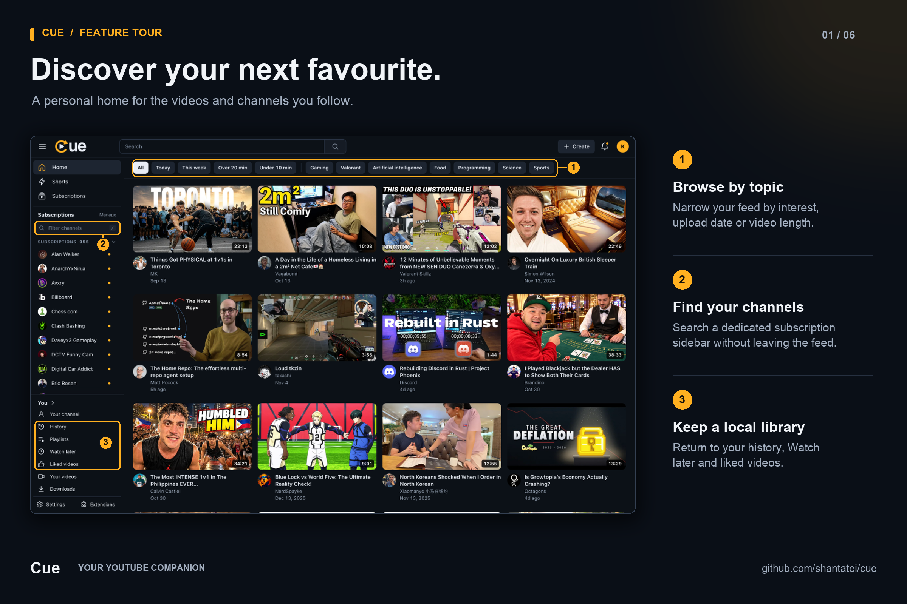
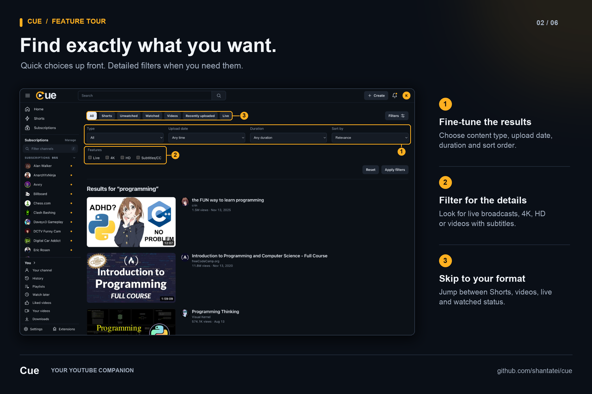
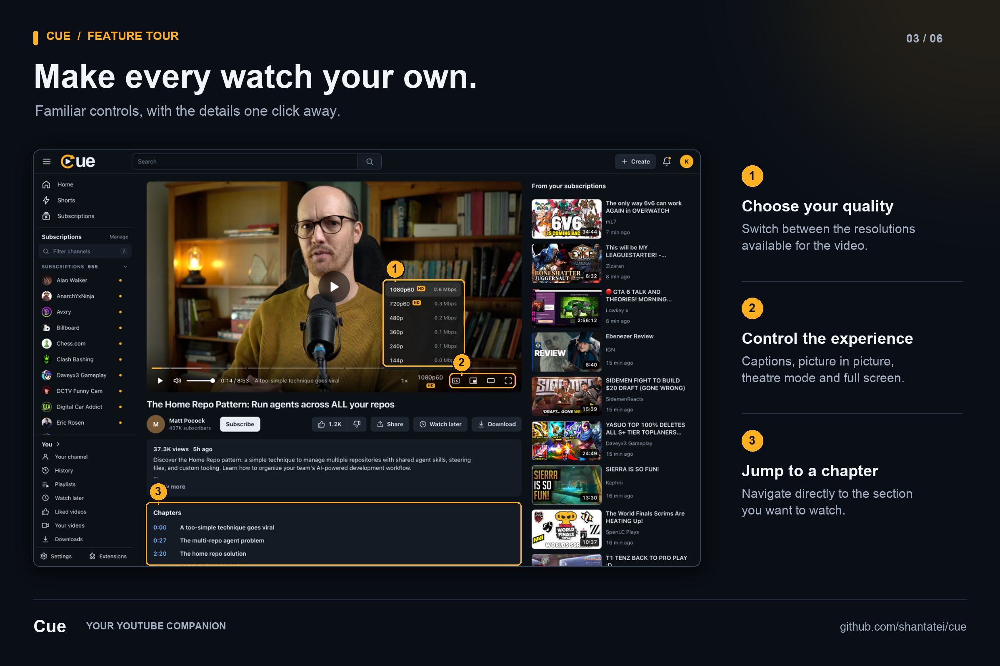
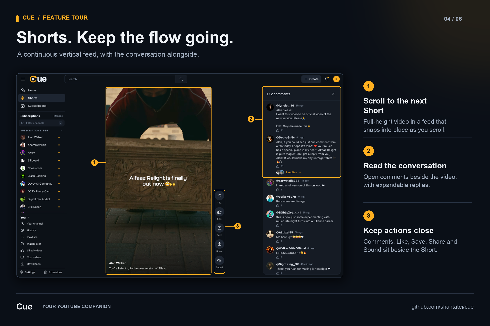
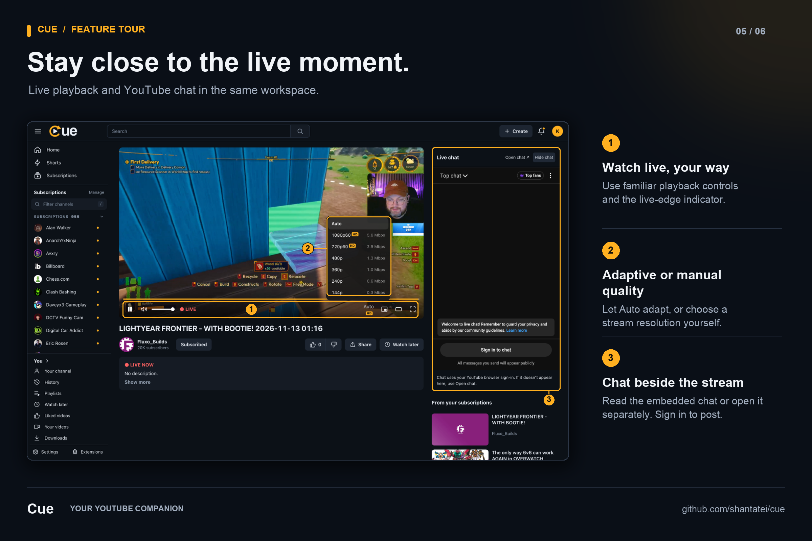
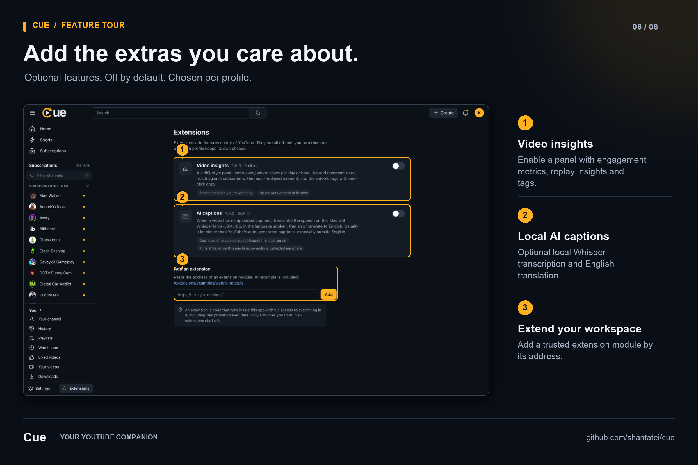

# Cue


Cue is a locally hosted YouTube companion for browsing subscriptions, discovering videos and watching live broadcasts. It brings organised channel navigation, continuous recommendations and a consistent player interface into one personal workspace.

> **Personal use only.** Cue is an independent hobby project. It is not affiliated with, endorsed by or sponsored by YouTube or Google, and it is intended for personal use on your own machine.

## Features

- **Ad-free playback:** Watch videos and Shorts in Cue's own player, without ads, at up to 4K.
- **Organised subscriptions:** Search channels, pin favourites and collapse groups within a bounded sidebar.
- **Continuous discovery:** Browse signed-in recommendations with automatic pagination, duplicate removal and topic filters based on video metadata.
- **Search and filtering:** Get search suggestions as you type, with keyboard navigation and filters for content type, upload date, duration, popularity, resolution and captions.
- **Video playback:** Choose playback quality, enable captions, navigate chapters and resume videos with familiar keyboard controls.
- **Live broadcasts:** Watch with synchronised audio, adaptive or manual quality selection, a Go live control and the same player controls used for regular videos.
- **Live chat:** View YouTube chat beside the stream, hide it when needed or open it in a separate window.
- **Personalisation:** Use local profiles, themes, watch history, saved videos and optional extensions, including video insights and local AI captions.
- **Shorts:** Scroll a continuous vertical feed of Shorts from followed channels, with comments, replies and quick actions beside the video. Filter videos by watched or unwatched status.

## Feature tour

Annotated screenshots highlight the controls behind each feature. Click an image to view it at full resolution.

**Discovery and subscriptions**



**Search and filtering**



**Video playback**



**Shorts and comments**



**Live broadcasts and chat**



**Optional extensions**



## Getting started

The current setup supports macOS with Homebrew. Install Node.js 24 or later, Python 3, `yt-dlp` and FFmpeg, then run the following commands from the project directory:

```sh
brew install node python yt-dlp ffmpeg
npm ci
npm start
```

Open [localhost:3000](http://localhost:3000). The server binds to `127.0.0.1`. To use a different port:

```sh
PORT=3001 npm start
```

`npm start` compiles the TypeScript source and prepares the application in `dist/` before starting the server. Rebuilding preserves existing account data and browser settings.

## Connecting YouTube

Cue displays sample content until a YouTube account is connected. To load your subscriptions and recommendations:

1. Sign in to YouTube in your browser.
2. Open **Settings → YouTube account** in Cue.
3. Connect the browser containing your YouTube session.

macOS may request browser or Keychain access during connection. Each Cue profile can connect its own account. Disconnecting an account removes Cue's saved login without signing you out of YouTube in your browser.

Live chat uses YouTube's official embed and the browser's YouTube session, separately from Cue's account connection. Sign in through YouTube to post messages; channel membership and subscriber restrictions still apply. Use **Open chat** if the embedded panel is unavailable.

## Privacy and local data

Account cookies, caches, downloaded media and optional speech models are stored locally in `data/`. Profile settings and local library data are stored in the browser.

Runtime data, login cookies, browser profiles and model files are excluded from version control. After cloning the repository, connect your own browser account to use personalised content.

## Optional AI captions

The AI captions extension is disabled by default. It requires a local `whisper-cli` installation and the following model files in `data/models/`:

- **Transcription:** `ggml-large-v3-turbo-q5_0.bin`
- **Translation:** `ggml-large-v3-q5_0.bin`

Available YouTube captions do not require these models. Live broadcasts are excluded from AI transcription.

## Development

Cue uses strict TypeScript for the frontend, Node.js server and developer scripts. The browser runs native ES modules without a UI framework. Python helpers handle browser account export and recommendation streaming.

```sh
npm run dev        # Watch source changes and restart the server
npm run typecheck  # Check TypeScript without generating files
npm run build      # Compile the application into dist/
```

Edit the TypeScript source files and refresh the browser after frontend changes. Source maps are included for browser and Node.js debugging; compiler errors appear in the terminal.

To start a Node.js debugging session on a separate port:

```sh
npm run build
PORT=3001 node --inspect --enable-source-maps dist/server.js
```

Live playback uses [hls.js](https://github.com/video-dev/hls.js), licensed under Apache-2.0. Its license is included in the built application's `public/vendor/` directory.

## Limitations

- Cue is an independent project and is not affiliated with YouTube or Google.
- Playback and account features depend on public YouTube responses and `yt-dlp`. Changes to YouTube may affect availability or require updates.
- Topic labels are derived from available metadata and do not reproduce YouTube's recommendation algorithm.
- Signed-in watch history may be incomplete. Shorts are drawn from followed channels rather than YouTube's personalised Shorts feed.
- Likes, watch-later saves and other library actions remain local to Cue and do not write back to YouTube.
- Embedded live chat depends on YouTube, browser sign-in and channel restrictions. YouTube does not support embedded chat on mobile web.
- Browsers using native HLS without MediaSource support select live playback quality automatically.
- The browser account export and local speech setup are tailored to macOS.
- Cue is intended for local use. The server has not been designed or hardened for public hosting.
